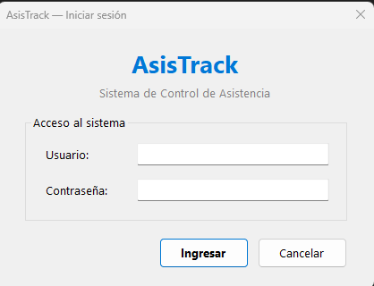
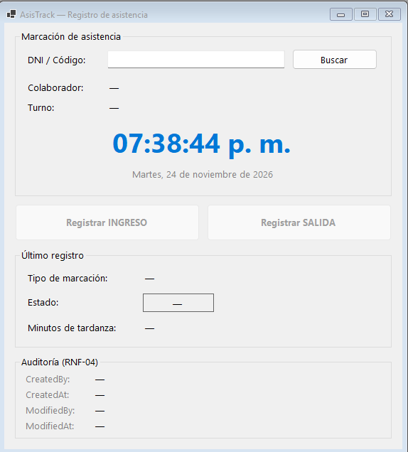
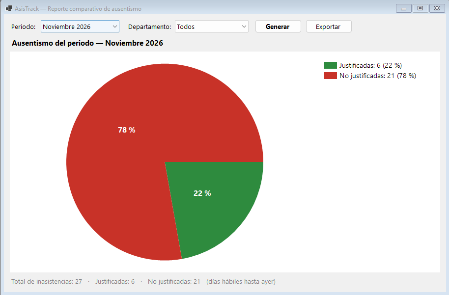

# AsisTrack – Sistema de control de asistencia del personal

Aplicación de escritorio para gestionar la asistencia del personal de una empresa. Reemplaza el registro manual (libros de actas y hojas de cálculo) por una **marcación con DNI** que toma la fecha y hora del servidor, calcula automáticamente las **tardanzas** según el turno y la tolerancia de cada colaborador, centraliza los **permisos y justificaciones** y genera **reportes** para la planilla y la toma de decisiones.

## Capturas

| Inicio de sesión | Marcación de asistencia |
|---|---|
|  |  |

**Reporte de ausentismo**



## Funcionalidades

- **Marcación de ingreso y salida por DNI**, con la hora del servidor de base de datos.
- **Cálculo automático de tardanzas** según el turno y la tolerancia de cada colaborador, incluidos **turnos que cruzan la medianoche** (por ejemplo, 22:00 – 06:00).
- **Justificaciones y permisos**: el colaborador los registra y RR.HH. o la jefatura los aprueba o rechaza.
- **Reportes**: tardanzas por área, ausentismo, horas extras e historial individual, con gráficos de barras y circular.
- **4 roles de usuario** con permisos distintos: Administrador RR.HH., Jefatura de área, Marcación y Colaborador.
- **Auditoría**: cada tabla registra quién creó o modificó cada registro y cuándo.
- **Contraseñas protegidas** con hash SHA-256.

## Tecnologías

| Área | Tecnología |
|---|---|
| Lenguaje | C# (.NET 8) con Programación Orientada a Objetos |
| Interfaz | Windows Forms (menú MDI y controles Chart) |
| Base de datos | SQL Server (tablas y procedimientos almacenados) |
| Acceso a datos | Entity Framework Core 8 (Database First) y LINQ |
| Arquitectura | 3 capas: Datos, Negocio y Presentación |

## Estructura del proyecto

```
AsisTrack/
├── CapaDatos/          Contexto de EF Core, entidades y clases DAO
├── CapaNegocio/        Reglas de negocio (tardanzas, turnos, justificaciones, reportes)
├── CapaPresentacion/   Formularios Windows Forms (login, marcación, mantenimientos, reportes)
├── database/
│   ├── AsisTrackDB.sql     Crea la base de datos, tablas, procedimientos y datos de prueba
│   └── PrepararDemo.sql    Ajusta los turnos de demostración a la hora actual
└── AsisTrack.sln
```

**Modelo de datos (6 tablas):** Rol, Usuario, Turno, Colaborador, Marcacion y Justificacion.

## Cómo ejecutarlo

**Requisitos:** Visual Studio 2022 con la carga de trabajo *Desarrollo de escritorio de .NET* (.NET 8) y SQL Server.

1. Abre `database/AsisTrackDB.sql` en SQL Server Management Studio y ejecútalo completo (F5).
2. Si tu instancia de SQL Server no es `localhost` (por ejemplo `.\SQLEXPRESS`), cambia `Server=localhost` en la constante `CadenaConexion` de `CapaDatos/AsisTrackDBContext.cs`.
3. Abre `AsisTrack.sln` en Visual Studio, define **CapaPresentacion** como proyecto de inicio y ejecuta (F5).
4. Opcional: para probar la demostración de marcación, ejecuta antes `database/PrepararDemo.sql`.

## Usuarios de prueba

| Usuario | Contraseña | Rol | Permisos |
|---|---|---|---|
| admin | admin123 | Administrador RR.HH. | Acceso total |
| avega | jefe123 | Jefatura de área | Marcación, justificaciones y reportes |
| kiosko01 | kiosko123 | Marcación | Solo registrar ingresos y salidas |
| lherrera | colab123 | Colaborador | Marcación e historial propio |
| cramirez | colab123 | Colaborador | Cuenta inactiva (para probar el bloqueo de acceso) |

**DNI de demostración** (pantalla de Marcación, después de ejecutar `PrepararDemo.sql`):

| DNI | Resultado esperado |
|---|---|
| 10000001 | Ingreso puntual |
| 10000002 | Ingreso con tardanza |
| 10000003 | Salida puntual |
| 10000004 | Salida con horas extra |

Todos los datos de prueba son ficticios.

## Autoría

Proyecto académico grupal (5 integrantes) de la carrera de Ingeniería de Sistemas de Información – Universidad Peruana de Ciencias Aplicadas (UPC), 2026.

**Guillermo Reyes Leandro** – Desarrollador principal: prototipo funcional, solución en 3 capas y reglas de negocio.
